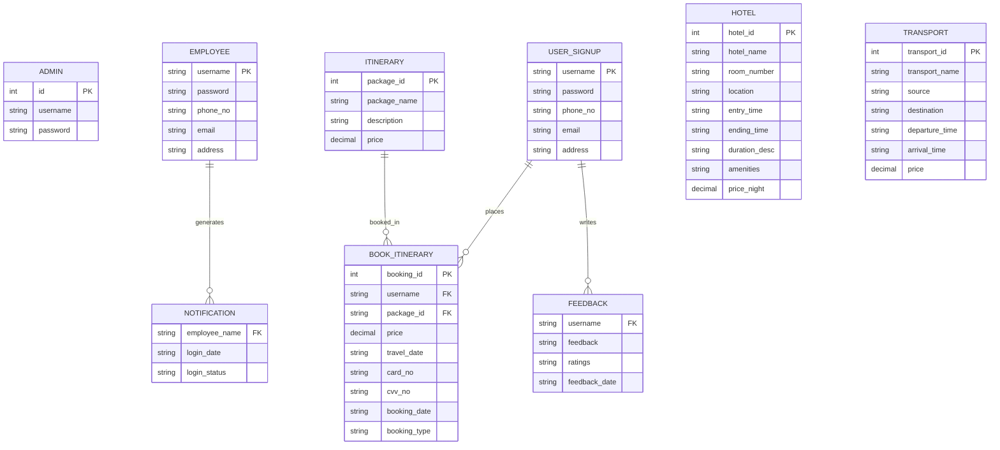
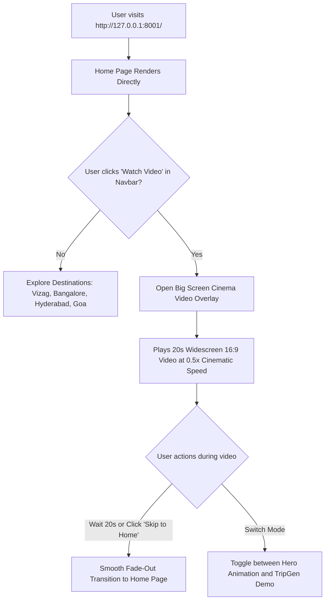

# TripGen — Travel Plan Itinerary Generator: Master Scratchpad & Complete Procedure

---

## 1. Executive Summary & Project Identity

- **Project Title:** TripGen *(Travel Plan Itinerary Generator & Logistics Management System)*
- **Primary Domain:** Tourism, Itinerary Planning, Hotel & Transport Logistics, Enterprise Operations
- **Core Vision:** To deliver a unified, self-contained travel intelligence platform where tour packages, lodging accommodations, and multi-modal transport logistics can be authored by staff, audited by administrators, and seamlessly booked by travelers through an intuitive, interactive web portal.

```
       +-----------------------------------------------------------------+
       |                  TRIPGEN WEB APPLICATION                        |
       |                   http://127.0.0.1:8001/                        |
       +--------------------------------+--------------------------------+
                                        |
                 +----------------------+----------------------+
                 |                      |                      |
                 v                      v                      v
        +-----------------+    +-----------------+    +-----------------+
        |  ADMINISTRATOR  |    |  STAFF/EMPLOYEE |    |    TRAVELER     |
        |  Portal & Audit |    | Operations Hub  |    | Booking Engine  |
        +-----------------+    +-----------------+    +-----------------+
```

---

## 2. Technical Stack Specification

### 2.1 Frontend Architecture
- **Structure:** Semantic HTML5 with native multimedia APIs (`<video>`, `<canvas>`, custom scrubbers, SVG icons).
- **Styling:** Vanilla CSS + Tailwind CSS (Crimson `#960000`, Deep Navy `#0c121e`, Slate `#1e293b`, Gold `#f3cf55`).
- **Typography:** Google Fonts (*Playfair Display*, *Poppins*, *Great Vibes* cursive accents).
- **Client Logic:** Vanilla JavaScript (ES6+):
  - Dynamic 20-second video playback rate calibration (`playbackRate = duration / 20.0`).
  - Edge-to-edge 16:9 aspect-ratio enforcement with zero pillarbox letterboxing.
  - Interactive destination card handlers, responsive navigation drawer, modal handlers.
  - Client-side validation for phone numbers, emails, and simulated payment credentials.

### 2.2 Backend Architecture
- **Language & Runtime:** Python 3.12+ (AMD64)
- **Framework:** Django Web Framework (Model-View-Template architecture)
- **Security:** CSRF token verification on all POST forms, session-based role authorization, SQL parameterization against injection.
- **Session Layer:** Django session engine tracking `request.session['user']` and `request.session['role']` (`'admin'`, `'employee'`, `'user'`).

### 2.3 Database Layer
- **Engine:** SQLite3 (`db.sqlite3`) with plug-and-play migration support for MySQL via PyMySQL.
- **Relational Tables:** 9 primary tables handling users, employees, admins, tour packages, accommodations, transport routes, booking transactions, feedback, and audit notifications.

---

## 3. Database Schema & Entity Relationships



---

## 4. End-to-End Operational Procedures

### Procedure A: System Initialization & Launch

1. **Working Directory:** Open terminal at the project root `c:\Users\style\Music\New folder\TravelApp1\TravelApp`.
2. **Virtual Environment Activation:**
   ```powershell
   .\venv\Scripts\activate
   ```
3. **Database Check & Migrations:**
   ```powershell
   python manage.py check
   python manage.py makemigrations
   python manage.py migrate
   ```
4. **Server Launch:**
   ```powershell
   python manage.py runserver 127.0.0.1:8001
   ```
   *(Alternatively, double-click [`run.bat`](file:///c:/Users/style/Music/New%20folder/TravelApp1/TravelApp/run.bat) which automates environment activation and launches the server).*
5. **Access Application:** Open any web browser to `http://127.0.0.1:8001/`.

---

### Procedure B: Public Landing & 20-Second Video Experience



1. **Home Direct Load:** Navigating to `http://127.0.0.1:8001/` or refreshing loads the Home page directly without popups.
2. **On-Demand Cinema Showcase:** Clicking `🎬 Watch Video` next to the TripGen logo opens the 16:9 edge-to-edge video player.
3. **Dual Video Switcher:**
   - **🎬 Hero Animation:** Plays `project_video.mp4` showcasing application architecture.
   - **🚀 TripGen Demo:** Plays `project_demo.mp4` showcasing end-user booking workflows.
4. **Automated Return:** At the 20-second mark (or by clicking *Skip to Home* / *OPEN HOME PAGE NOW*), the overlay transitions into the interactive Home page.

---

### Procedure C: Administrator Complete Workflow

```
[AdminLogin.html] -> [AdminScreen.html] -> [AddEmployee.html] -> [ViewEmployee.html] -> [ViewAuthEmployee.html]
```

1. **Admin Login:**
   - Navigate to `Admin Login` in navbar (`http://127.0.0.1:8001/AdminLogin.html`).
   - Enter Administrator credentials verified against `TravelApp_admin`.
   - On success, redirects to `AdminScreen.html`.
2. **Staff Onboarding (`AddEmployee.html`):**
   - Click `Add Employees`.
   - Enter `Username`, `Password`, `Phone Number`, `Email`, and `Office Address`.
   - Form posts to `/AddEmployeeAction`, writing records to the `employee` table.
3. **Staff Directory Oversight (`ViewEmployee.html`):**
   - Click `View Employees` to inspect all registered staff members in a formatted data table.
4. **Authentication & Audit Logging (`ViewAuthEmployee.html`):**
   - Click `View Authenticated Employees` to audit staff sign-in activity and verify timestamps stored in the `notification` table.
5. **Session Termination:** Click `Logout` to flush the session and return to the Home page.

---

### Procedure D: Staff / Employee Complete Workflow

```
[EmployeeLogin.html] -> [EmployeeScreen.html] -> [Itinerary / Hotels / Transport / ViewBookings / ViewFeedback]
```

1. **Employee Login:**
   - Navigate to `Employee Login` (`http://127.0.0.1:8001/EmployeeLogin.html`).
   - Submits credentials to `/EmployeeLoginAction`, verified against `employee`.
   - Logs login event to `notification` table and opens `EmployeeScreen.html`.
2. **Itinerary & Tour Management:**
   - **Create Package:** Access `Create Itinerary` (`CreateItinerary.html`), enter package name, detailed day-by-day itinerary description, and package price.
   - **Modify/Delete:** Access `ViewItinerary.html` / `ModifyItinerary.html` to adjust rates, update descriptions, or remove obsolete packages.
3. **Accommodations Management (`Hotels.html`):**
   - Access `Add Hotels` (`AddHotel.html`).
   - Enter Hotel Name, Room Number, Destination City, Entry/Ending Times, Duration description, Amenities list, and Nightly Rate.
   - Edit existing stays via `ModifyHotel.html`.
4. **Transportation Logistics (`Transport.html`):**
   - Access `Add Transport` (`AddTransport.html`).
   - Register Transport Service (Flight/Train/Bus), Origin city, Destination city, Departure time, Arrival time, and Fare.
   - Review or modify existing routes in `ViewTransport.html`.
5. **Customer Orders & Reviews:**
   - **View Bookings (`ViewBookings.html`):** Real-time monitoring of traveler reservations with payment verification records.
   - **View Feedback (`ViewFeedback.html`):** Review customer ratings and suggestions.

---

### Procedure E: Traveler / End-User Complete Workflow

```
[Register.html] -> [UserLogin.html] -> [SearchItinerary.html] -> [BookItinerary.html] -> [ViewBookings]
```

1. **Account Registration (`Register.html`):**
   - Click `New User Signup`.
   - Enter Username, Password, Phone Number, Email, and Address.
   - Submits to `/RegisterAction`, checking for duplicate usernames.
2. **Traveler Authentication (`UserLogin.html`):**
   - Enter credentials to authenticate into the User Dashboard.
   - Redirects to `SearchItinerary.html` with active session.
3. **Exploring & Booking Tour Packages:**
   - Browse itinerary cards on the left panel. Click any card to inspect full details on the right interactive panel.
   - Click `Book Package` to navigate to `BookItinerary.html`.
   - Select Travel Date, enter 16-digit Card Number, Expiry, and CVV.
   - Submits to `/BookItineraryAction`, which creates a unique Booking ID and records the transaction.
4. **Exploring & Booking Transportation:**
   - Click `Search Transport` (`SearchTransport.html`).
   - Filter by Origin, Destination, and Departure Schedule.
   - Click `Book Ticket` (`BookTransport.html`) and confirm seat reservations.
5. **Exploring & Booking Hotels:**
   - Click `Search Hotels` (`SearchHotels.html`).
   - Compare amenities (Pool, WiFi, Breakfast, Air Conditioning) and nightly rates.
   - Click `Reserve Room` (`BookHotel.html`) and confirm dates.
6. **Trip Cancellation & Management (`CancelBookings`):**
   - View all active reservations. Click `Cancel Booking` to release reservations and update records.
7. **Submitting Reviews & Ratings (`Feedbacks.html`):**
   - Share trip feedback, star ratings, and review comments saved to the `feedback` table.

---

## 5. Master URL Routing Dictionary

| Endpoint URL | View Function | Accessible Roles | Description |
| :--- | :--- | :--- | :--- |
| `/` | `views.index` | Public | Main landing page with destination cards & on-demand video trigger |
| `/FAQ.html` | `views.FAQ` | Public | FAQ helpdesk & traveler documentation |
| `/Logout` | `views.Logout` | All | Flushes session and redirects to Home |
| `/AdminLogin.html` | `views.AdminLogin` | Public | Administrator login screen |
| `/AdminLoginAction` | `views.AdminLoginAction` | Public (POST) | Authenticates administrator credentials |
| `/AdminScreen.html` | `views.AdminScreen` | Admin | Administrator control center |
| `/AddEmployee.html` | `views.AddEmployee` | Admin | Form to add new staff members |
| `/AddEmployeeAction`| `views.AddEmployeeAction`| Admin (POST) | Saves new employee record to database |
| `/ViewEmployee.html`| `views.ViewEmployee` | Admin | Directory of all staff members |
| `/ViewAuthEmployee.html`| `views.ViewAuthEmployee` | Admin | Audit log of staff sign-ins |
| `/EmployeeLogin.html`| `views.EmployeeLogin` | Public | Staff portal login |
| `/EmployeeLoginAction`| `views.EmployeeLoginAction`| Public (POST) | Authenticates staff credentials & logs timestamp |
| `/EmployeeScreen.html`| `views.EmployeeScreen` | Employee | Staff management dashboard |
| `/CreateItinerary.html`| `views.CreateItinerary` | Employee | Form to author new travel tour package |
| `/CreateItineraryAction`| `views.CreateItineraryAction`| Employee (POST) | Inserts new tour package into database |
| `/ViewItinerary.html`| `views.ViewItinerary` | Employee | View/edit list of all packages |
| `/ModifyItinerary.html`| `views.ModifyItinerary` | Employee | Form to update package details/price |
| `/DeleteItinerary` | `views.DeleteItinerary` | Employee | Deletes specified itinerary package |
| `/AddHotel.html` | `views.AddHotel` | Employee | Form to register new hotel stay |
| `/AddHotelAction` | `views.AddHotelAction` | Employee (POST) | Inserts hotel record into database |
| `/ViewHotel.html` | `views.ViewHotel` | Employee | View/modify list of hotel properties |
| `/ModifyHotel.html` | `views.ModifyHotel` | Employee | Form to update hotel pricing & details |
| `/DeleteHotelAction`| `views.DeleteHotelAction`| Employee | Removes hotel property from registry |
| `/AddTransport.html`| `views.AddTransport` | Employee | Form to register flight/bus/train route |
| `/AddTransportAction`| `views.AddTransportAction`| Employee (POST) | Inserts transport route into database |
| `/ViewTransport` | `views.ViewTransport` | Employee | View list of all transport routes |
| `/ModifyTransport.html`| `views.ModifyTransport` | Employee | Form to modify transport schedules/fare |
| `/DeleteTransport` | `views.DeleteTransport` | Employee | Deletes transport route |
| `/UserLogin.html` | `views.UserLogin` | Public | Traveler login screen |
| `/UserLoginAction` | `views.UserLoginAction` | Public (POST) | Authenticates traveler credentials |
| `/Register.html` | `views.Register` | Public | Traveler registration screen |
| `/RegisterAction` | `views.RegisterAction` | Public (POST) | Registers new traveler account |
| `/SearchItinerary` | `views.SearchItinerary` | Traveler | Interactive itinerary search & details |
| `/BookItinerary` | `views.BookItinerary` | Traveler | Booking checkout form for package |
| `/BookItineraryAction`| `views.BookItineraryAction`| Traveler (POST) | Processes simulated payment and saves booking |
| `/SearchTransport` | `views.SearchTransport` | Traveler | Search bus/flight/train connections |
| `/BookTransport` | `views.BookTransport` | Traveler | Checkout form for transport tickets |
| `/SearchHotels` | `views.SearchHotels` | Traveler | Search hotels with amenities & rates |
| `/BookHotel` | `views.BookHotel` | Traveler | Checkout form for hotel stay |
| `/ViewBookings` | `views.ViewBookings` | Traveler/Staff | View all active travel reservations |
| `/CancelBookings` | `views.CancelBookings` | Traveler | Cancel reservation interface |
| `/Feedbacks.html` | `views.Feedbacks` | Traveler | Form to submit service feedback & ratings |
| `/ViewFeedback` | `views.ViewFeedback` | Staff/Traveler | View public customer reviews & ratings |

---

## 6. Project Directory Hierarchy

```
TravelApp/
├── manage.py                          # Django CLI controller
├── run.bat                            # 1-click startup batch script
├── db.sqlite3                         # Local SQLite relational database
├── db.txt                             # SQL schema reference definition
├── SCREENS.docx                       # Documentation & screenshot archive
│
├── Travel/                            # Django project configuration module
│   ├── settings.py                    # App configuration, middleware, DB settings
│   ├── urls.py                        # Root URL router
│   ├── wsgi.py                        # WSGI server entrypoint
│   └── __init__.py
│
├── TravelApp/                         # Primary application package
│   ├── models.py                      # Django ORM models (Admin, Employee, User, Hotel, etc.)
│   ├── views.py                       # All business logic, controllers & action handlers
│   ├── urls.py                        # Complete URL routing definitions
│   │
│   ├── static/                        # Project static assets
│   │   ├── images/                    # Destination cards (Vizag, Bangalore, Goa, Hyderabad)
│   │   └── videos/                    # 4K showcase videos (project_video.mp4, project_demo.mp4)
│   │
│   └── templates/                     # 34 Complete HTML5 application templates
│       ├── index.html                 # Main landing page with 20s cinema video player
│       ├── AdminLogin.html            # Admin authentication
│       ├── AdminScreen.html           # Admin dashboard
│       ├── AddEmployee.html           # Admin: Add staff
│       ├── ViewEmployee.html          # Admin: Staff directory
│       ├── ViewAuthEmployee.html      # Admin: Staff audit logs
│       ├── EmployeeLogin.html         # Staff authentication
│       ├── EmployeeScreen.html        # Staff dashboard
│       ├── CreateItinerary.html       # Staff: Author tour package
│       ├── ViewItinerary.html         # Staff: Tour package directory
│       ├── ModifyItinerary.html       # Staff: Update package
│       ├── AddHotel.html              # Staff: Author hotel stay
│       ├── ViewHotel.html             # Staff: Hotel directory
│       ├── ModifyHotel.html           # Staff: Update hotel
│       ├── AddTransport.html          # Staff: Author transport route
│       ├── ViewTransport.html         # Staff: Transport directory
│       ├── ModifyTransport.html       # Staff: Update transport
│       ├── ViewBookings.html          # Staff/User: Reservation records
│       ├── ViewFeedback.html          # Staff/User: Feedback oversight
│       ├── UserLogin.html             # Traveler login
│       ├── Register.html              # Traveler signup
│       ├── UserScreen.html            # Traveler dashboard
│       ├── SearchItinerary.html       # Traveler: Search & view tour packages
│       ├── BookItinerary.html         # Traveler: Tour booking checkout
│       ├── SearchTransport.html       # Traveler: Search transit routes
│       ├── BookTransport.html         # Traveler: Transit checkout
│       ├── SearchHotels.html          # Traveler: Search hotels & stays
│       ├── BookHotel.html             # Traveler: Hotel checkout
│       ├── Feedbacks.html             # Traveler: Submit trip rating
│       └── FAQ.html                   # Traveler: Helpdesk & support
│
└── venv/                              # Python virtual environment
```

---

## 7. Diagnostic & Verification Checklist

- [x] **Dev Server Port:** Verified active on `127.0.0.1:8001`.
- [x] **Zero Integrity Errors:** `manage.py check` confirms 0 silenced issues.
- [x] **Video Splash Screen Behavior:**
  - Default state: `hidden` (`display: none;`). Clicking `Home` or pressing `F5` refreshes the page directly without opening the video.
  - Video trigger: Clicking `🎬 Watch Video` in the navbar launches the 20-second widescreen video player.
  - Geometry: Exact 16:9 ratio, zero gaps at the top (`mt-0`, `justify-start`), and bottom action buttons fully visible.
- [x] **Role Separation:** Admin, Employee, and Traveler dashboards have segregated authorization paths and distinct workflows.
